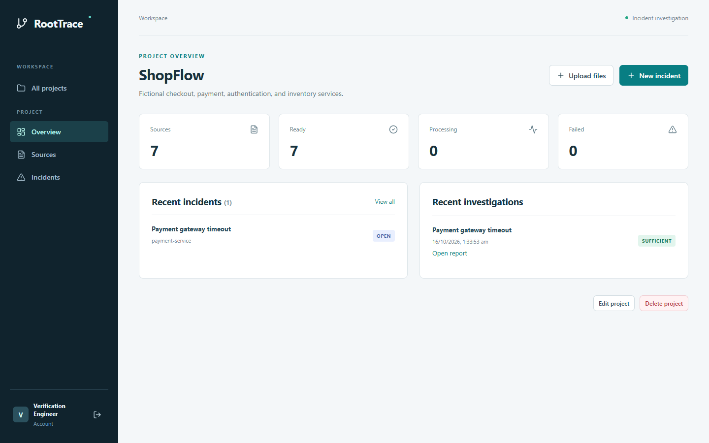
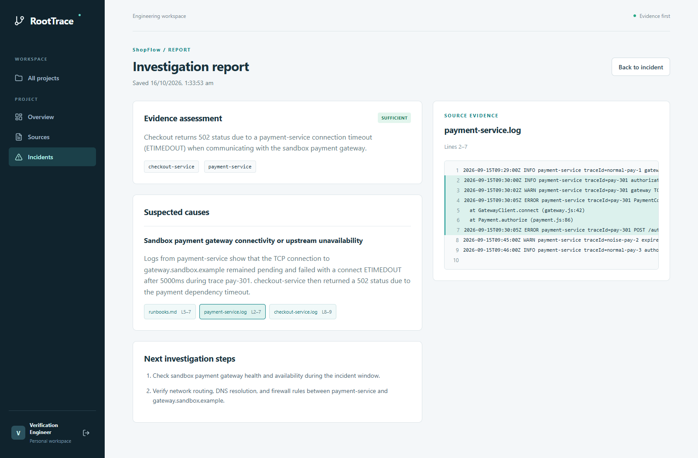
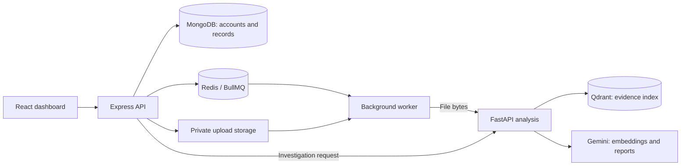

# RootTrace

### Find the evidence behind an application failure.

RootTrace helps developers investigate incidents using application logs and optional documentation. Upload relevant files, describe the problem, and get a saved report with suspected causes, suggested checks, and clickable references to the original file lines.

[Quick start](#quick-start) · [Try the demo](#try-it-with-shopflow) · [How it works](#how-it-works) · [Documentation](#documentation)



_The project overview keeps uploaded files, incidents, and saved investigations together. All screenshots use fictional ShopFlow data._

## What RootTrace helps you do

- **Find relevant evidence.** Search across uploaded logs and documents for information related to an incident.
- **Understand a suspected cause.** Read an explanation supported by specific source references.
- **Check the original lines.** Select a citation to open its file, line numbers, and nearby context.
- **Decide what to check next.** Review suggested investigation steps and whether the available evidence is sufficient.
- **Keep investigations organized.** Separate projects, track file processing, and revisit saved reports.

For example, if checkout requests return `502` and payment logs contain connection timeouts, RootTrace can connect those records, suggest a payment dependency problem, and point to the supporting lines. The developer still confirms the cause and makes the fix.

## What users upload

| Input                | Example                                                                       | Required?                                  |
| -------------------- | ----------------------------------------------------------------------------- | ------------------------------------------ |
| Application logs     | Errors, failed requests, timeouts, stack traces                               | Relevant logs are the usual starting point |
| Documentation        | Service descriptions, API notes, known problems, troubleshooting instructions | Optional; adds context                     |
| Incident description | “Customers cannot complete payments; checkout returns 502.”                   | Yes, entered in the incident form          |

Supported files: **`.log`, `.txt`, `.json`, and `.md`**, with a configurable **20 MB limit per file**. Select multiple files together; each has its own upload and processing status. Files must contain valid text.

Users obtain logs from their application, server, or hosting platform and upload them manually. Uploading the entire codebase is not required.

## Investigation preview



_Select a source citation to inspect the original lines beside the report. The layout stacks on smaller screens: [mobile preview](docs/screenshots/report-mobile.png)._

Reports distinguish three evidence levels:

| Result         | Meaning                                                                                      |
| -------------- | -------------------------------------------------------------------------------------------- |
| `SUFFICIENT`   | The uploaded evidence supports an explanation; the developer should still confirm the cause. |
| `PARTIAL`      | Some useful evidence exists, but more information or checks are needed.                      |
| `INSUFFICIENT` | The available evidence does not support a cause.                                             |

## Quick start

### 1. Install dependencies

Prerequisites: **Node.js 24**, **Python 3.11**, **Git**, and credentials for MongoDB, Redis, Qdrant, and Gemini. No Docker or design plugins are required.

From the repository root, on Windows PowerShell:

```powershell
npm ci
py -3.11 -m venv ai-service/.venv
ai-service/.venv/Scripts/python.exe -m pip install -r ai-service/requirements-lock.txt
npm run env:setup
```

<details>
<summary>macOS / Linux installation</summary>

```bash
npm ci
python3.11 -m venv ai-service/.venv
ai-service/.venv/bin/python -m pip install -r ai-service/requirements-lock.txt
npm run env:setup
```

Use `ai-service/.venv/bin/python` for the Python commands below.

</details>

### 2. Configure private service credentials

`env:setup` prepares the ignored root `.env` file, generates missing session/internal secrets, and preserves existing values. Fill in these settings privately:

| Variable                           | What to provide                                                                          |
| ---------------------------------- | ---------------------------------------------------------------------------------------- |
| `MONGODB_URI`                      | MongoDB Atlas connection string with a dedicated database name                           |
| `REDIS_URL`                        | Redis **TCP over TLS** URL beginning with `rediss://`; an Upstash REST URL will not work |
| `QDRANT_URL` / `QDRANT_API_KEY`    | Qdrant Cloud endpoint and key                                                            |
| `GEMINI_API_KEY`                   | Gemini access for embeddings and report generation                                       |
| `JWT_SECRET` / `AI_SERVICE_SECRET` | Separate secrets generated by `env:setup`                                                |

See [`.env.example`](.env.example) for all settings. Keep Redis eviction disabled. Never commit `.env`, upload credentials as evidence, or put provider secrets in `VITE_*` variables.

### 3. Start the application

```powershell
npm run doctor
npm run start:local
```

Open **http://localhost:5173**, register using your own name, email, and password, then sign in. There is no shared default login. Passwords must be 10–72 characters and no more than 72 UTF-8 bytes.

The launcher starts four processes:

| Process                  | Local address / role                   |
| ------------------------ | -------------------------------------- |
| React frontend           | `http://localhost:5173`                |
| Express API              | `http://127.0.0.1:5000`                |
| BullMQ worker            | Background file processing and cleanup |
| FastAPI analysis service | `http://127.0.0.1:8000`                |

Keep the launcher running while using the app. Press **Ctrl+C** in its terminal to stop. Run `npm run doctor -- --live` to check readiness. Use the hostname configured in `CLIENT_URL` consistently when opening the frontend.

## Try it with ShopFlow

The repository includes a fictional shopping application with four service logs and three documents.

1. Create a project named **ShopFlow**.
2. Open **Sources → Upload files**. Select the four files in [`demo-data/logs`](demo-data/logs), then upload the three files in [`demo-data/docs`](demo-data/docs) in another batch. Keep automatic source type detection.
3. Click **Upload files** for each selection. Wait until all seven files show **`READY`**. If a file fails, review its message and retry from Sources.
4. Choose **New incident** and enter:

   | Field               | Example                                                                                                                                                |
   | ------------------- | ------------------------------------------------------------------------------------------------------------------------------------------------------ |
   | Title               | Payment gateway timeout                                                                                                                                |
   | Problem description | Checkout returns 502 while payment-service connections to the sandbox gateway remain pending and time out after 5000ms. Trace pay-301 shows ETIMEDOUT. |
   | Affected service    | `payment-service`                                                                                                                                      |
   | Time window         | Leave blank for this demo                                                                                                                              |

5. Select **Investigate incident**.
6. Read the suspected cause and suggested checks. Select a `payment-service.log` citation to inspect its original lines.

The report is saved under the incident and linked from the project overview. Report wording can vary; provider errors or quota limits are shown as failures rather than replaced with sample results.

If processing reports a **provider usage limit**, the file is still saved. Wait for the provider limit to reset, then use **Retry** on Sources instead of uploading the same file again. Processing waits between rate-limit retries and respects provider retry timing when supplied.

## How it works



Uploads return `202 Accepted` after queueing; the worker processes files separately. Parsing keeps original line references, document sections, and stack traces. Investigation searches the project's ready sources, validates the generated report and its citation references, and saves the result.

| Layer            | Technology                                              |
| ---------------- | ------------------------------------------------------- |
| Frontend         | React, Vite, JavaScript, React Router, Axios, plain CSS |
| API and accounts | Express, Mongoose, Zod, bcrypt, HttpOnly JWT cookies    |
| Background jobs  | BullMQ, Redis TCP/TLS                                   |
| Analysis         | Python 3.11, FastAPI, LangChain, Pydantic, Gemini       |
| Storage          | MongoDB metadata, private files, Qdrant vectors         |

Default models are `gemini-3.5-flash-lite` and `gemini-embedding-2`, with 768-dimensional embeddings. LangChain provides the embedding interface, project-scoped retriever, chat prompt, and structured Gemini report chain. Existing embedding formats, vector IDs, and citation metadata are preserved. Model settings are configurable; changing embedding models or dimensions requires a separate collection and reindexing.

## Current scope

RootTrace investigates **existing incidents using uploaded evidence**. It does not automatically monitor applications, collect logs, scan a connected codebase, predict future failures, or apply fixes. A suspected cause is an investigation result, not a guarantee.

Project ownership is enforced on API operations, and retrieval is limited to the selected project's ready sources. Project deletion uses retryable cleanup for vectors, files, and records. Passwords are hashed, session cookies are HttpOnly, and production cookies require HTTPS.

The current deployment layout uses shared API/worker upload storage and **one FastAPI process**. Managed services and provider quotas are required; idle workers also consume Redis commands. No public deployment is included. See the [deployment guide](docs/deployment.md) before hosting.

## Development and checks

```powershell
npm run lint
npm run build
npm test
ai-service/.venv/Scripts/python.exe -m ruff check ai-service/app ai-service/tests
ai-service/.venv/Scripts/python.exe -m pytest -c ai-service/pytest.ini ai-service/tests
npm audit
npm run scan:secrets
```

Build before running tests so the production static-serving check is exercised. Install [Gitleaks](https://github.com/gitleaks/gitleaks/releases) for secret scanning; Windows also recognizes an ignored `.tools/gitleaks.exe`.

<details>
<summary>Run processes separately</summary>

Run each command in its own terminal:

```powershell
npm run dev:client
npm run dev:server
npm run dev:worker
ai-service/.venv/Scripts/python.exe -m uvicorn app.main:app --app-dir ai-service --host 127.0.0.1 --port 8000 --reload --reload-dir ai-service/app
```

Windows also supports `./scripts/start.ps1` as an alternative to the combined launcher.

</details>

<details>
<summary>Live browser and queue checks</summary>

These checks require configured services and the running local application:

```powershell
npm run test:queue -w server
npm run test:browser -- --cleanup
```

The browser check creates fictional accounts, uploads the seven demo files, investigates an incident, opens a saved report and citation, checks project ownership and mobile navigation, and deletes its test project. Artifacts stay under ignored `.local/browser`.

Windows uses installed Edge. On macOS/Linux, run `npx playwright install chromium` first. Live checks consume service/provider quota.

</details>

GitHub Actions runs the client build, isolated Node/React/Python tests, dependency checks, and a full-history secret scan without production credentials. See the [verification record](docs/verification.md) for coverage and limitations.

## Documentation

| Guide                                       | Contents                                                                 |
| ------------------------------------------- | ------------------------------------------------------------------------ |
| [Architecture](docs/architecture.md)        | Services, data models, REST interfaces, and job lifecycle                |
| [Retrieval and reports](docs/rag-design.md) | Chunking, project isolation, evidence retrieval, and citation validation |
| [Verification](docs/verification.md)        | Automated coverage, live checks, and practical limits                    |
| [Deployment](docs/deployment.md)            | Native hosting, private storage, configuration, and operations           |
| [Interview notes](docs/interview-notes.md)  | Implementation decisions and tradeoffs                                   |
